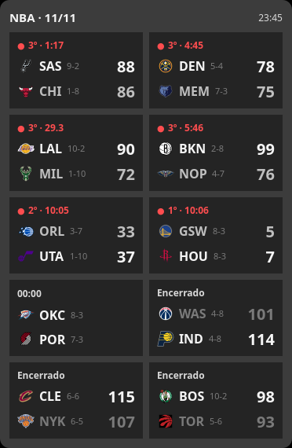

# nba-scoreboard-widget

Floating PyQt6 widget for X11 with the live NBA scoreboard of the night: team logos, records, scores, quarter and clock. The window has no border and stays on top of the desktop.



## Requirements

- Linux with an X11 session
- Python 3.11 or newer
- Internet access to `site.api.espn.com`

## Installation

```bash
git clone https://github.com/fberbert/nba-scoreboard-widget.git
cd nba-scoreboard-widget
python3 -m venv .venv
.venv/bin/pip install -e .
.venv/bin/nba-scoreboard-widget
```

### Application launcher

To show the widget in the desktop application menu, create `~/.local/share/applications/nba_scoreboard_widget.desktop` (adjust the paths to where you cloned the repository):

```ini
[Desktop Entry]
Name=NBA Scoreboard Widget
Comment=Live NBA scoreboard floating on the desktop
Exec=/path/to/nba-scoreboard-widget/.venv/bin/nba-scoreboard-widget
Path=/path/to/nba-scoreboard-widget
Icon=/path/to/nba-scoreboard-widget/assets/icon.png
Terminal=false
Type=Application
Categories=Utility;Sports;
StartupWMClass=nba-scoreboard-widget
```

Then run `update-desktop-database ~/.local/share/applications`.

## Usage

- Drag to move. The position is saved.
- `q` quits, `r` refreshes now.
- `+` / `-` change the scale.
- `[` / `]` change the number of columns.
- Live games come first (red dot, quarter and clock), then upcoming games (local tipoff time), then finished ones. The leading team is bright, the losing team of a finished game is dimmed, and a score that goes up flashes green for 4 seconds.

The interface text is in Brazilian Portuguese.

## Data

Scores come from ESPN's public scoreboard (`site.api.espn.com/apis/site/v2/sports/basketball/nba/scoreboard`), which returns the current slate. No API key is needed.

Refresh: every 15 s while a game is live; otherwise it waits for the next tipoff (30 s to 15 min); 15 min when the slate is over; 60 s after a failed request (the header shows `sem conexão` and the last scores stay).

## Configuration

`${XDG_CONFIG_HOME:-$HOME/.config}/nba-scoreboard-widget/config.json`:

```json
{
  "ui": {
    "scale": 1.0,
    "columns": 2,
    "position": null
  }
}
```

## Project structure

- `src/nba_scoreboard_widget/espn.py` - ESPN payload parsing, pt-BR status text, refresh schedule.
- `src/nba_scoreboard_widget/widget.py` - floating Qt widget, game cards, logo rendering, HTTP via `QNetworkAccessManager`.
- `src/nba_scoreboard_widget/config.py` - persistent UI config.
- `src/nba_scoreboard_widget/assets/logos/` - team logo SVGs.
- `tests/` - unit tests.

## Tests

```bash
.venv/bin/python -m unittest discover -s tests
```

## License

The code is released under the [MIT License](LICENSE).

NBA and team names and logos are trademarks of the NBA and its teams. This project is not affiliated with or endorsed by the NBA or ESPN.
